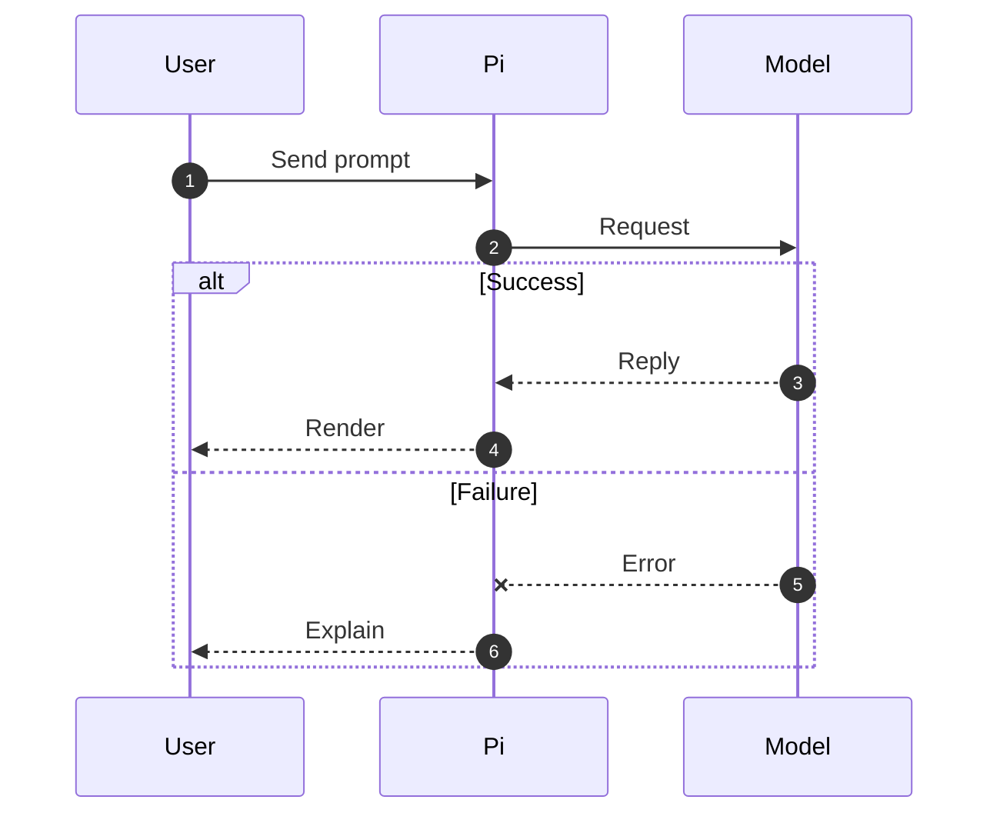

# Mermaid diagrams for Pi

Follow these rules when a Mermaid diagram should render in Pi's terminal transcript.

## Output

- Put each diagram in a top-level fenced block tagged `mermaid`.
- Use a supported type: `flowchart`, `stateDiagram-v2`, `classDiagram`, `erDiagram`, or `sequenceDiagram`.
- Keep explanation outside the diagram instead of embedding paragraphs in labels or notes.

## Fit the terminal

Pi renders Unicode art only when the complete diagram fits the transcript width; otherwise it shows the Mermaid source. Aim for at most 72 columns to leave room for transcript padding.

- Split complex systems, phases, or branches into multiple diagrams.
- Limit sequence diagrams to 3-4 participants when possible.
- Use short participant labels and message text; long messages push lifelines apart.
- Put IDs, metrics, dates, and detailed failure explanations in prose below the diagram.
- Prefer several small diagrams over one comprehensive diagram.

## Use the terminal-safe subset

For sequence diagrams, rely on participants, messages, self-messages, notes, `autonumber`, `loop`, `alt`, and `opt`.

- Do not rely on `rect` colors or backgrounds; Pi does not draw them.
- Do not use ` `; Pi renders it literally rather than as a line break.
- Avoid Mermaid initialization directives, themes, styling, links, and browser-only features.
- Activation, creation, and destruction statements may be accepted without a visual representation.
- If unsupported syntax is necessary, explain that Pi may show the source instead of a diagram.

## Sequence template

Before answering, simplify any diagram that has long labels, more than four lifelines, or multiple independent phases.
